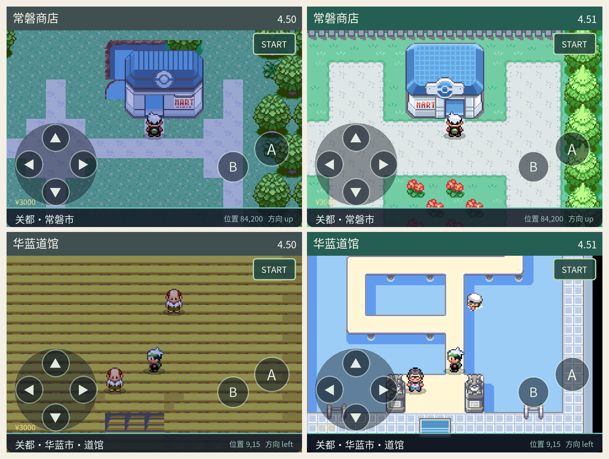

# PokeSaga · 安卓学习版

用 Godot 4.7.2 开发的横屏宝可梦同人 RPG。当前学习版为 `4.61.0-study`，versionCode 为 94，包名为 `com.stepx.pokesaga.study`。它可以和 4.46 版同时安装，两份应用分别保存进度。

[下载 4.61 安卓学习版（ARM64 APK）](https://github.com/zachshi-ai/pokesaga/releases/download/v4.61.0-study/PokeSaga-4.61.0-study.apk) · [查看发布说明](https://github.com/zachshi-ai/pokesaga/releases/tag/v4.61.0-study)

## 从美乐美乐岛开始四岛巡礼

打开 **START → 背包 → 重要道具 → 地区转移器 → 阿罗拉**。第一次抵达先选把队伍寄存到电脑，或带现有队伍出发，再在四个版本中选一个。在美乐美乐岛自己的卧室打开 **START → 工具 → 阿罗拉版本**，也可以在同一份档里开始另一版，之后切回继续。四条巡礼分别记进度。小悠从好奥乐市郊的家醒来，之前的伙伴、箱子、图鉴、资金和各地名人堂都接着用。

| 选择 | 御三家与美乐美乐霸主 | 波尼岛与联盟 | 通关后 |
| --- | --- | --- | --- |
| 太阳 | 利利小镇领伙伴，霸主猫鼬探长 | 露莎米奈与虚吾伊德、索尔迦雷欧，最后挑战库库伊 | 跟莉拉与帅哥调查异兽，含爆肌蚊、纸御剑 |
| 月亮 | 利利小镇领伙伴，霸主阿罗拉拉达 | 露莎米奈与虚吾伊德、露奈雅拉，最后挑战库库伊 | 异兽调查中出现费洛美螂、铁火辉夜 |
| 究极之日 | 1号道路领伙伴，霸主猫鼬探长 | 日食奈克洛兹玛、究极大都会、茉莉的考验，联盟迎战哈乌 | 波尼树林遇砰头小丑，进入彩虹火箭队篇 |
| 究极之月 | 1号道路领伙伴，霸主阿罗拉拉达 | 月食奈克洛兹玛、究极大都会、茉莉的考验，联盟迎战哈乌 | 波尼树林遇垒磊石，进入彩虹火箭队篇 |

岛上的骑行许可按当地主线取得。第一次用 Z 招式时，跟库库伊和岩狗狗实战，在战斗菜单打开「特殊行动」。此后让伙伴携带对应的 Z 纯晶，选择兼容的招式，每方每场可发动一次。月亮和究极之月的岛上时钟与太阳系版本相差十二小时。

[巡礼、角色与卫冕](doc/阿罗拉巡礼.md) · [支线、道具与取得条件](doc/阿罗拉支线与道具.md) · [四岛与究极空间怎样转为俯视地图](doc/阿罗拉地图.md)

[安卓模拟器实拍 · 四版选择](.github/preview/v4.61-alola-versions.png) · [利利小镇的御三家](.github/preview/v4.61-alola-starters.png) · [库库伊与岩狗狗的 Z 招式教学](.github/preview/v4.61-alola-z-tutor.png) · [大都会塔的究极奈克洛兹玛](.github/preview/v4.61-alola-necrozma.png) · [联盟的库库伊](.github/preview/v4.61-alola-kukui.png)

## 从朝香镇到卡洛斯联盟

从标题选「继续冒险」，打开 **START → 背包 → 重要道具 → 地区转移器 → 卡洛斯**。首次抵达先选带队或寄存，再选《X》或《Y》。小悠在朝香镇的卧室醒来，对着镜子换衣服，出门见莎莉娜和莎娜，到名水镇露天桌找提耶鲁诺领御三家。之前地区的队员、电脑、图鉴和名人堂都在原存档里。

第三馆后，在精练之塔顶用可尔妮的路卡利欧实战学习超级进化。到石香镇的闪焰队基地，《X》会遇到哲尔尼亚斯，《Y》会遇到伊裴尔塔尔。选定的版本也决定部分野生宝可梦和超级石。八枚徽章、四天王、冠军卡露妮和 AZ 庆典按顺序衔接。通关后可以搭 TMV 到奇楠市，挑战对战宅第、升级超级环，再去密阿雷市完成帅哥侦探事务所的六章故事。[卡洛斯主线与实测](doc/卡洛斯旅程.md) · [支线、特殊道具和开放条件](doc/卡洛斯支线与道具.md)

[首次前往卡洛斯的队伍选择](.github/preview/v4.60-kalos-entry.png) · [名水镇领取御三家](.github/preview/v4.60-starters.png) · [精练之塔的超级进化](.github/preview/v4.60-mega.png) · [光辉之间的卡露妮](.github/preview/v4.60-diantha.png)

关都可以带伙伴去两岛参加无线小游戏，城都可以按星期参加捕虫大会、拼阿露福遗迹石板，丰缘可以报名五种华丽大赛、挑战八间戏法屋或收集开拓象征。各地区共用主角、队伍、箱子和图鉴。[三作支线入口、奖励与验证范围](doc/三作支线.md)

[水静市华丽大赛安卓实拍](.github/preview/v4.57-contest.png) · [五轮后的得分和排名](.github/preview/v4.57-contest-results.png) · [阿露福遗迹触屏拼图](.github/preview/v4.57-alph.png) · [石板打开后出现未知图腾](.github/preview/v4.57-alph-open.png)


全程操控《绿宝石》的小悠。阿银、空木博士、城都八位馆主、四天王、渡和赤红各自沿用剧情身份，并采用对应人物的 GBA 风格像素图。[城都人物对照与素材署名](doc/城都角色素材.md) · [在白银山与赤红同屏的安卓实拍](.github/preview/v4.55-red.png)

**地区转移器**随新档发放，旧档选择「继续冒险」后也会出现在背包里。探索时点 **START → 背包 → 重要道具 → 地区转移器**，选地区，再点「出发前往」。可以从屋内、洞窟、水上或异空间出发。首次进入有开场剧情的地区，会先到剧情起点，之后再去会抵达领航员旁。21 个目的地从开局就能选择，道具可重复使用，到达后自动保存。首次进入城都、丰缘、神奥、合众或卡洛斯会接上当地的开场剧情。 [查看背包实拍](.github/preview/v4.52-region-transfer.png)



[查看战斗动图：皮卡丘使用十万伏特时，水伊布的 HP 从 132 降至 79](.github/preview/v4.51-battle-hp.gif)

## 从鹿子镇出发，两年后在桧扇市再启程

用地区转移器选「合众」。第一次抵达可以带着现有队伍，也可以把它们寄存在共享电脑。你仍然操作《绿宝石》的小悠。在鹿子镇的卧室拆开礼盒，从藤藤蛇、暖暖猪和水水獭中选择，再和白露、黑连出发。走完八馆、N 的城堡和魁奇思后，回鹿子镇家里一楼和妈妈说话。可以继续前篇的通关后冒险，也可以选择进入两年后，再决定这次带谁去桧扇市。

两段采用《黑》接《黑2》的版本差异。两年后先在桧扇市的瞭望台找白露，走过另外八个道馆、等离子驱逐舰与巨人洞窟，最后挑战冠军艾莉丝。两段分别检查徽章、秘传许可、宿敌与等离子队事件。打赢艾莉丝后，在合众家里打开 **START → 工具 → 回忆链接** 可以往返两个年代，继续捕捉、交换和完成支线。[合众支线、版本差异与实测范围](doc/合众两段旅程.md)

[第一次到合众的队伍选择](.github/preview/v4.59-unova-entry.png) · [N 在城堡迎战](.github/preview/v4.59-n.png) · [冠军房里的艾莉丝和小悠](.github/preview/v4.59-iris.png) · [艾莉丝派出三首恶龙](.github/preview/v4.59-iris-battle.png)

## 从双叶镇到神奥联盟

从背包的地区转移器选神奥。第一次到访可以把队伍寄存到同一份存档的电脑，也可以带上现有伙伴。两种选择都从双叶镇小悠的卧室开始。到 201 号道路从山梨博士的手提箱里选草苗龟、小火焰猴或波加曼，第一次和阿驯交手时用自己刚选的伙伴。之后可以照常在宝可梦中心交换队员。再次前往神奥时会接着当地进度。

神奥按《白金》的房间、道路、门和机关布局，用 GBA 图块重绘。按黑金、百代、家缘、帷幕、野原、水脉、雪峰、滨海的顺序挑战道馆。从银河队在谷间发电厂的行动、三座湖泊和银河总部，一路追到枪之柱。毁坏的世界保留由克希、艾姆利多、亚克诺姆引路的推石谜题。神奥单独记录徽章、道具和人物状态。携带外区冠军队伍也要完成本地剧情，队员学会秘传招式后仍需取得神奥对应的徽章才能在场地使用。

| 支线 | 到哪里玩 |
| --- | --- |
| 宝芬与超级华丽大赛 | 在家缘市领宝芬盒、烹饪树果并喂给队员，到会场报名装扮、舞蹈和才艺比赛。奖章保存在参赛宝可梦身上。 |
| 钢铁岛、大湿地和地下挖掘 | 在水脉码头乘船找亚玄领取怪力，到野原市购买大湿地入场券，或带探险套装到地下挖掘。 |
| 每日活动 | 到祝庆电视台一楼核对队伍和电脑里的训练家 ID 参加抽奖。取得全国图鉴后，可以在宝可梦豪宅听主人公布自豪后院新出现的宝可梦。 |
| 随意镇培育屋与七星餐厅 | 培育屋能寄放两只伙伴，走路后可查询培育情况、领蛋或付费领回。立志湖畔的七星餐厅在每天 9 点到 23 点营业，桌边的顾客可以双打。 |
| 名人堂后的对战开拓区 | 从雪峰市搭船到对战区。五处设施可以报名挑战，获得的 BP 可在两处交换柜台兑换道具和招式学习器。 |

在帷幕市东南的民房找小丑领取代币盒，再去游戏厅。全国图鉴开放后，可以从共享电脑挑六只伙伴参加伙伴公园的捕捉表演。名胜区的别墅可以订购 20 件家具。华丽大赛、挖掘和游戏厅采用触屏操作。原版的历史配信道具在本作内领取，伙伴公园的迁入来源为这份存档的电脑箱。

在百代市找地下大叔领探险套装，可以下地挖矿。秘密钥匙可打开百代银河队大楼的隐藏房间，让洛托姆使用里面的家电；会员卡对应水脉市港口旅馆，大木的信对应 224 号道路的白色岩石。

[首次进入神奥的队伍选择](.github/preview/v4.58-entry.png) · [毁坏的世界地下三层](.github/preview/v4.58-distortion.png) · [在冠军室与竹兰见面](.github/preview/v4.58-cynthia.png) · [神奥地图、人物和汉化来源](content/platinum_native/credits.txt)

## 从未白镇到丰缘联盟

标题的「新的冒险」从关都真新镇开始。第一次通过道路、船或地区转移器前往丰缘时，可选「乘坐搬家货车」或「直接抵达」。乘车时车厢和纸箱会随路面颠簸，停稳后车门透光，向右走下车。两种方式都在未白镇遇见妈妈。以后再去丰缘，仍可选乘车重看这一段，剧情只推进一次。先上自己家二楼调钟，再去隔壁家见小遥。随后向北走到 101 号道路，从小田卷博士的背包里选木守宫、火稚鸡或水跃鱼。

已有进度时选「继续冒险」。第一次去丰缘时，如队伍中已有宝可梦，游戏会询问如何安置。选「寄存队伍，重新组队」会把现有队员按顺序放进电脑空位，选「带现有队伍出发」可以带着伙伴走同一段剧情。两条路都沿用当前存档的背包、金钱、图鉴和名人堂记录。寄存时如果电脑空间不足，整队仍在手里。到过的旧地区可以用地区转移器返回。

丰缘徽章和秘传学习器分别记录获得进度。挑战橙华道馆的千里需要先取得四枚当地徽章。冲浪在战胜千里后由满充的父亲交给小悠，潜水要先完成绿岭宇宙中心的事件，再去大吾家领取。琉璃道馆在烈空坐平息固拉多和盖欧卡后开放。联盟依次挑战花月、芙蓉、波妮、源治和冠军米可利。

[安卓实拍 · 琉璃市的固拉多与盖欧卡](.github/preview/v4.56-sootopolis.png) · [安卓实拍 · 彩幽联盟冠军米可利](.github/preview/v4.56-wallace.png)

地图、地形、人物位置和训练家队伍的重建数据取自同一个《绿宝石》版本。[丰缘特殊道具获取与使用](doc/丰缘特殊道具.md) · [绿宝石源数据与地图脚本](https://github.com/pret/pokeemerald/tree/9103e529c2fbdd7add4a1ff3350c6c1f92112c42/data/maps)

## 从若叶镇到白银山

从关都经地区道路或地区转移器第一次进入城都，在若叶镇下楼从妈妈手中领取宝可装置，再到空木研究所从菊草叶、火球鼠和小锯鳄中选择伙伴。送回神奇的蛋后就能领精灵球。城都采用《水晶》的事件顺序，包括圆朱烧焦塔的水君线、满金电台和烟墨龙穴的问答。

集齐八枚城都徽章后，从若叶镇向东穿过都城瀑布和冠军之路，挑战四天王和阿渡。进名人堂后回若叶镇找空木博士领船票。搭水流号到枯叶，从发电厂找回零件、为收音机扩充频道，到拿齐关都八枚徽章。最后找真新镇的大木博士开放白银山，在山顶挑战赤红。[剧情与角色出场顺序](doc/城都剧情与人物.md) · [特殊道具获取与用法](doc/城都特殊道具.md)

在关都从尼比市往东走 3 号道路，首次进入月见山时，阿银会带着六只宝可梦等你。打赢后，每逢手机本地时间周一、周三，走到石英高原宝可梦中心东北侧通向四天王的走廊，可以再和他对战。当天获胜后他会离开，下一个约战日还会回来。

## 从真新镇开始

启动游戏先到《绿宝石》的烈空坐标题页。选择「新的冒险」从真新镇家中二楼的床边出发。走到右上方墙图前面朝上按 A，可翻看世界全景地图。在丰缘索引点「丰缘地图」，可以缩放《绿宝石》宝可导航的地区地图。下楼出门，走到真新镇北边的草丛，大木会带你去研究所领取初始伙伴。在研究所出口和小茂对战后，前往常磐商店领取包裹，交回大木后会同时收到图鉴和 5 个精灵球，常磐市北面的老人也会让路。草丛里可以遇敌、投球、练级，常磐市的宝可梦中心可以治疗队伍。经 2 号道路和常磐森林抵达尼比市，打赢小刚即可获得首枚徽章。本作沿用皮卡丘作为初始伙伴，小茂从伊布开始培养。

九个主地区与十二个附属区域均有地图、步行入口和领航员，墙图登记了 561 个地点。24 条跨区通道包括海堤、栈道、隧道及山口。第一次从真新镇出发，可以直接找家外的领航员，点目标地区，再点「出发前往」。地图室、道路、道馆与室内房间保留各自的碰撞和进出点。新建地区侧重探索与交通。关都可以挑战到名人堂和七岛后日谈，城都可以走到白银山挑战赤红，丰缘可以走到彩幽联盟挑战米可利，神奥可以在《白金》的联盟挑战竹兰，合众可以走完两个年代，卡洛斯可以在光辉之间挑战卡露妮。

关都与七岛的 375 张地图采用《火红／叶绿》的 16 像素图块、调色板、地形属性和出入口编号。华蓝道馆的木桥可以步行，面向池水按 A 并确认冲浪后才会下水。城都沿用《心金／魂银》的房间尺寸、地形和出入口，用《火红／叶绿》和《绿宝石》的图块绘制场景。其他自建地区主要使用《绿宝石》素材。[地图与素材说明](doc/素材重建.md)

## 关都与七岛怎么玩

| 到了哪里 | 下一段剧情 |
| --- | --- |
| 华蓝市、枯叶市 | 到海角的小屋帮助正辉，拿船票上圣安奴号。在船上遇到小茂，帮助船长取得居合斩。船开走后，可从岸上继续挑战枯叶道馆。 |
| 玉虹市、紫苑镇、金黄市 | 从游戏厅海报找火箭队基地，取电梯钥匙和检视镜。在宝可梦塔顶救出富士老人，用宝可梦之笛唤醒卡比兽。金黄的守卫需要茶，西尔佛公司的门要用钥匙卡。 |
| 浅红市、红莲岛 | 在狩猎地带取金假牙和冲浪，替园长找回假牙学怪力。去宝可梦屋操作雕像开关，找到道馆的秘密钥匙。打赢夏伯后，正辉会在馆外邀请你去七岛。 |
| 第一次去七岛 | 到一之岛见锦辉，去三之岛赶走暴走族，在果实森林找回迷路的女孩，回二之岛交陨石。这段完成后可以回关都继续收集徽章。 |
| 常磐市、石英高原 | 打赢坂木，带齐八枚徽章通过关卡，推开胜利之路的岩石，连胜四天王与冠军，登记名人堂。 |
| 第二次去七岛 | 登记名人堂并实际拥有过 60 种关都宝可梦后，回真新镇找大木升级图鉴。去一之岛帮锦辉找红宝石，持彩虹通行证前往后续岛屿，帮助科拿、调查点之穴和火箭队仓库，取回蓝宝石并修复网络。 |

主线台词按本作改写。大木、小茂、正辉、富士老人、坂木、科拿和火箭队成员随事件登场或离开。可以用地区转移器提前看地图，推动剧情仍需在场景里完成对应事件。

## 特殊道具从哪里拿

关都的秘传学习器需到各自的赠送人或拾取点领取。居合斩找圣安奴号船长，冲浪找狩猎地带最深处的管理员，攀瀑要亲自穿过四之岛的薄冰。枯叶市、浅红市和 12 号道路的钓鱼人分别赠送破旧钓竿、好钓竿和厉害钓竿。在关都或七岛使用时，水域和竿的种类决定鱼群。

商店中打开「进化材料产地」，可以查到 40 种进化材料的购买地区。六之岛水路能捡到龙之鳞片，给海刺龙使用即可进化为刺龙王。在枯叶市宝可梦中心可以领取对战搜寻器，走满 100 步后在附近有已打败训练家的室外地点使用。地图上的学习器可教学，携带道具从队伍界面装备，战斗强化道具从场上的背包使用。[逐件查看获取地点、价格和使用示例](doc/进化道具获取.md)

标题页、背包、丰缘导航图和战斗场地采用原游戏图块与配色。前三世代宝可梦优先采用《绿宝石》正背面及异色，后来登场的宝可梦和形态使用与之相配的像素图。

## 队伍与触屏菜单

探索时点右上角 **START**，右侧会弹出图鉴、队伍、背包、电脑、工具和存档。点「工具」可以骑行、进入秘传或打开修改器，在宝可梦中心还能进入融合工坊。队员会飞翔或闪光时，在「秘传」选中该招即可使用，也可以教给其他队员。关掉图鉴等页面后，光标会回到刚才那一行。点地图空白处可直接收起菜单。键盘 Enter 开菜单，上下键选择、Enter 确认、Esc 返回。手柄可用 START、方向键及 A/B。

战斗时，右下角固定显示「战斗」「背包」「宝可梦」「逃跑」四项。点「战斗」查看每招的属性、威力和剩余 PP。当场可用的变身、Z 招式和太晶化在「特殊行动」里。出招时，受击一方的血条和 HP 数值一同逐渐下降，按各自行动顺序结算。点「宝可梦」可以滑动查看最多 12 名队员并换人。

- 同行队伍可带 12 只。满员后捕获的成员进电脑；在电脑中点选具体成员存入或取回，最后一只留在队伍中。旧存档的单箱收藏会迁入电脑。
- 队伍、背包、图鉴、修改器共用触屏控件。可以在卡片上直接滑动，松手后再点选。修改器支持按名字或编号查找、选招式和道具，保存后同时写入队伍与背包；取消会放弃本次草稿。
- 图鉴以主编号组织形态，1,025 个战斗物种归入 1,003 个主条目。按本作设计，22 只悖谬种归在其原型下。遇见铁辙迹后，输入 `990` 或铁辙迹可打开顿甲 No.0232 中的铁辙迹，战斗与存档继续使用铁辙迹自己的物种 ID。
- 图鉴默认列出已经见过的编号，详情只显示实际遇到或拥有的形态、闪光和战斗状态组合。地区形态、Mega、超极巨、不同属性、颜色、花纹和造型可单独查看。星星闪和方块闪共用该形态真实的异色配色，预览与战斗使用不同的闪光图形。太晶化按实际发动时的属性收录。多形态示例包括彩粉蝶的 20 种花纹、未知图腾的 28 种字形，以及霜奶仙的 9 种奶油 × 7 种糖饰。
- “该编号已捕获”表示物种收集进度。“已见过此外观”和“已拥有此外观”对应具体形态、闪光和太晶组合。查看图鉴不会新增记录。旧个体只有布尔型闪光字段时按星星闪迁移，缺少个体证据的旧历史只保留编号进度。

## 从源码安装

在 Godot 4.7.2 中导入本目录的 `project.godot`，按 F6 运行当前场景或 F5 启动游戏。命令行从项目根目录执行：

```bash
godot --headless --path . --import
godot --path .
tools/build_android.sh ../交付/PokeSaga-4.59.0-study.apk
```

构建 Android 需要匹配的 Godot 导出模板、JDK 17、Android SDK、platform-tools、build-tools 和 Godot 可访问的本机调试签名。已配置的机器可用 `GODOT_BIN`、`JAVA_HOME`、`ANDROID_HOME` 选择工具路径。本机脚本也识别 `~/Library/Application Support/PokeSagaBuild`。学习版使用 `Android Study` 导出预设，目标架构为 ARM64，输出为签名调试 APK。安装可用 `adb install -r ../交付/PokeSaga-4.56.0-study.apk`。

## 验证改动

以下命令分别从标题新建存档，验证首次进入丰缘或神奥、打赢当地冠军以及重启后的名人堂记录。

```sh
python3 tools/test_hoenn_journey.py --godot godot --result-save /tmp/hoenn-champion.json
godot --headless --path . --script tools/test_hoenn_travel.gd
godot --headless --path . --script tools/test_region_journey.gd
python3 tools/test_sinnoh_journey.py --godot godot
godot --headless --path . --script tools/test_sinnoh_entry.gd
godot --headless --path . --script tools/test_sinnoh_side.gd
godot --headless --path . --script tools/test_sinnoh_contests.gd
godot --headless --path . --script tools/test_sinnoh_frontier.gd
godot --headless --path . --script tools/test_sinnoh_park_arcade.gd
godot --headless --path . --script tools/test_sinnoh_villa.gd
godot --headless --path . --script tools/test_sinnoh_dailies.gd
godot --headless --path . --script tools/test_sinnoh_breeding_dining.gd
```


```bash
godot --headless --path . -- --selftest
godot --headless --path . --script tools/test_world_returns.gd
godot --headless --path . --script tools/test_world_walks.gd
godot --headless --fixed-fps 60 --path . --script tools/test_field_mapping.gd
godot --headless --fixed-fps 60 --path . --script tools/test_firered_passages.gd
godot --headless --fixed-fps 60 --path . --script tools/test_frlg_story.gd
godot --headless --fixed-fps 60 --path . --script tools/test_world_atlas.gd
godot --headless --fixed-fps 60 --path . --script tools/test_region_transfer.gd
godot --headless --path . --script tools/test_npc_appearances.gd
python3 tools/test_first_chapter.py --godot /path/to/godot
python3 tools/test_kanto_journey.py --godot /path/to/godot
python3 tools/test_johto_journey.py --godot /path/to/godot
godot --headless --fixed-fps 60 --path . --script tools/test_kanto_campaign.gd
godot --headless --fixed-fps 60 --path . --script tools/test_evolution_items.gd
godot --headless --fixed-fps 60 --path . --script tools/test_collection.gd
godot --headless --fixed-fps 60 --path . --script tools/test_start_menu.gd
godot --headless --fixed-fps 60 --path . --script tools/test_battle_commands.gd
godot --headless --path . --script tools/test_dex_catalog.gd
godot --headless --fixed-fps 60 --path . --script tools/test_dex_sightings.gd
godot --headless --fixed-fps 60 --path . --script tools/test_battle_hp.gd
godot --headless --fixed-fps 60 --path . --script tools/test_johto_passage.gd
godot --headless --fixed-fps 60 --path . --script tools/test_johto_league.gd
godot --headless --fixed-fps 60 --path . --script tools/test_hoenn_ferry.gd
```

城都长流程从标题页另开若叶镇新档，经八馆、冠军之路、联盟、关都八馆和白银山。测试会在赤红战后重新读取存档，逐项核对队伍、背包、图鉴、徽章、名人堂和所在地图。特殊道具的通关档补测入口为 `tools/test_johto_item_journey.py --save <save.json> --godot <Godot>`。两条路线都支持用 `--pack` 指定从 APK 提取的游戏数据。角色出场与解锁条件可查阅[《金／银》白银山开放事件](https://github.com/pret/pokegold/blob/2bbfba60051acfbed96d68fb5e40173a06df67d8/maps/OaksLab.asm)及[《水晶》白银山山顶事件](https://github.com/pret/pokecrystal/blob/9ce4c4e5068ffdf56e23ca3d8dc9178b2465d482/maps/SilverCaveRoom3.asm)。

关都长流程从独立新档出发，通过游戏操作行走、捕捉、练级、交任务和打馆。通关后重启游戏，核对八枚徽章、名人堂、收藏、背包及七岛网络进度。联盟专项另测中途战败重置和强化版再战。手机图鉴专项 `tools/test_android_dex.py --help` 列出设备序列号、ADB 与截图目录参数；它在已安装学习版的横屏模拟器上按游戏画面坐标点击。

## 从素材开始学习

游戏自带运行所需的素材，直接导入工程即可游玩。重新制作图片、碰撞和音频的步骤及素材版本见 [素材重建说明](doc/素材重建.md)。核心代码集中在 `core/`，各触屏菜单在 `scenes/`，地图、剧情、招式、道具和形态表在 `content/`。

本项目用于非商业同人学习。宝可梦的名称与形象归相应权利人所有。中文字库的开放字体许可随 `assets/fonts/OFL.txt` 提供。
