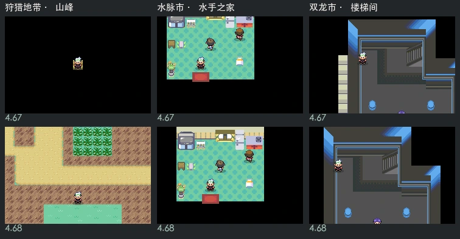

# 城都、神奥和合众逐图走查

[逐图数据](ds.tsv) 中每行对应一个地图版本或状态。用 `map_id` 查地图，最后几列给出[游戏画面总览](../../.github/preview/v4.68/ds)的文件名和图上编号。截图使用游戏内小悠、场景绘制、出生点和镜头。查看通路需要结合步行和出口列，单个出生点截图只展示一屏。

| 数据来源 | 走查的地图及状态 |
| --- | ---: |
| 心金的城都、关都重访和设施地图头 | 518 |
| 延用水晶的房间及城都通路 | 22 |
| 白金通常状态 | 551 |
| 白金花之乐园、花之通道和 224 号道路的开放状态 | 3 |
| 神奥跨区通路 | 2 |
| 黑和黑2的合众地点及设施实例 | 426 + 616 |
| 合众跨区通路 | 4 |

桌面 Godot 直接读取正式签名安卓包的游戏资源。2,142 张地图或状态中，小悠从 2,116 张的默认落点走出了至少一步，另有 4 张从地图内的其他可走格开始，全表共实走 203,120 步。其余 22 个都是心金地图头，包括 18 个原作未使用场景、2 个磁浮列车过场和 2 个狩猎区测试模板。普通游戏的列车站台另有地图头。 APK SHA-256 为 `21d286c496716d28fb097fcf0b46c5055aaf8fe48845bc69a2a2d7de98ac326a`。

10,179 个出口和场内机关中，8,993 个到达了指定地图的指定坐标，1,144 个触发图内移动，8 个触发自行车桥上下层切换，6 个按跨区规则调整了落点，6 个由道馆机关改送其他位置。初始剧情状态有 21 个人物占用门槛，开放后另做条件走查。白金冠军室的南梯由原作剧情升降台脚本驱动，普通步行探测没有触发。原作静态事件另比对了 4,500 条，其中 4,382 条同格同目标，放宽一格时有 4,385 条符合。[神奥和合众人物门槛的实测条件](ds-door-staff.tsv)

黑有 50 张、黑2有 154 张记录带版本替用、联机设施、按事件加载等说明，可查 `version_or_instance`。黑与黑2各按本版矩阵和事件表核对。白和白2的完整场景差异没有经过同样的逐版走查。

## 改动与复查

- 在心金的地图矩阵中，狩猎地带的 12 种地形由游戏运行时装入。以前编译器从传送点推算可达地板，导致没有独立传送点的区块整块变黑。现在从开放边缘恢复原作碰撞，按原始地面材质、树丛和水面，以 16 像素的绿宝石和火红叶绿素材重铺。第一套默认布局连接六片区域，东西南北每侧均沿原始可通过的缺口衔接。玩家可以在巴奥巴开放区域配置机后，自由更换任意槽位，或交换已放入的两种地形。配置保存在同一份存档，下一次入园时正南槽位连到门厅。12 种地形都可由此进入。放置装饰物及其解锁的额外遭遇尚未实现。园内捕捉使用项目已有的原野球遭遇界面及捕捉公式。
- 狩猎地带售票处从柜台顾客一侧入园并返回。用独立存档点过取消、买票和返程，750 元购票后余 250 元、获得 30 枚原野球，离园时交回。12 种地形分别接入心金的基础遭遇表。39 号道路保留了与巴奥巴交换电话的原始触发位置；需要让浅葱灯塔的电龙康复才能买票。第一关要出示自己在园内捕捉的小拳石，累计三小时游戏时间后巴奥巴来电通知启用配置机，第二关在沙漠捕捉穿山鼠。测试通过实际捕捉、柜台对话与配置菜单检验了两次考验及旧档读写，三小时来电采用推进游戏时钟的边界测试。默认六片从柜台出发、回大厅共走了 302 步并切图 12 次；换入另外六片后走了 308 步并切图 12 次。
- 心金的对战工厂、对战城堡、对战轮盘、对战舞台、灯塔、广播塔、百货商店及尼比科学博物馆改用了对应功能的绿宝石地板。对战设施、办公室、展馆和商店各用本类公共建筑的地砖。原场景有地毯的区域按原模型材质铺设。迁移公园南门改到原始地面上的朝南触发格，回到园内的落点在门槛以北。
- 白金 290 张、黑 189 张、黑2 252 张地图的镜头按绘制出来的房间、行走格和前后遮挡家具收边。合众另有 394 张室内图清除了原模型外、不可站立处的底层地砖。门槛与走廊保留原来的地面。
- 合众海底遗迹一楼有 4,422 格相连的水下地面。以前编译器把这些格当成需要冲浪的水域，把四个潜水井出口和通往二楼的楼梯吸附到彼此隔绝的干地。现在四扇门分别按原始坐标定位，上层按原版脚本楼梯连接，返回竖井后恢复游泳。黑和黑2各从一楼走遍四个井口，再经二楼、三楼上四楼并返回，每版连续 1,544 步、14 次切图。旧版存档如果滞留在孤立格，重载后会定位到连通地面。

## 表格读法

`native_events` 是原始地图头引用的事件数量。接下来的两列核对目标地图及原始触发坐标，分别统计严格同格和至多相隔一格。原作的动态电梯、合并的宽门、移除的未使用出口、采用按键事件的入口，以及由连接矩阵产生的边界，都可能与静态传送事件计数不同。合众部分由脚本装载的实例单列处理。

`default_spawn_steps`、`exercised_steps` 和 `visited_cells` 分别记录从默认落点实际走出的步数、实走测试的步数及不同坐标数。每张图探索最多 96 步；个别地图的默认格紧挨机关，走查工具会从另一块可达地面单独试走并保留默认落点的结果。每道门另从相邻格或方向格调用正式的移动、按键和动画结束逻辑。`exact_transfer` 要求传送信号的目的地和坐标均正确。`field_movement` 记录落差、浮石等图内移动。`observations` 保留剧情人物暂时拦路、传送机关改写目的地等实际观察。例如白金冠军室的南梯由原作脚本启动升降台，测试保留它的剧情条件。

原版坐标、材质和地图矩阵使用本地来源核验。心金采用 pokeheartgold `4e9563397ab4`，白金采用 pokeplatinum `485c400f9d7b`，黑采用 pokeblack `67d91a78b16c`，黑2采用 pokebw2 `345b790e6000`。作为地砖参考的绿宝石版本为 pokeemerald `9103e529c2fb`。表记录地图数据与游戏实测，后续检查原作同位置的前后景遮挡时仍可沿用坐标和截图编号。
