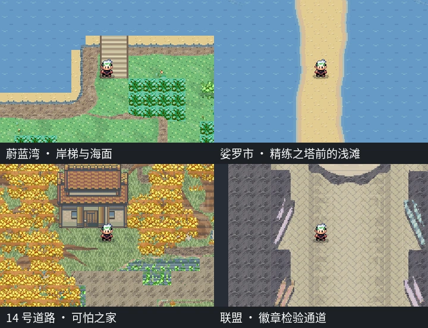

# 卡洛斯的海路、湿地和联盟入口

| 地点 | 原作入口格 | 从哪里走 |
| --- | --- | --- |
| 蔚蓝湾 → 海神之穴 | 72, 71 | 在 12 号路找海岸，从水上往北切进蔚蓝湾，游到洞口所在的小岛。出洞回到岛上的 71, 71。 |
| 14 号道路 → 可怕之家 | 10, 22 | 在湿地沿步道和桥走到西北侧，站在小屋南侧往上进门。往香薰市要沿北方步道走到地图边界。 |
| 娑罗市 → 精练之塔 | 41, 40 | 从城镇向北踏上浅色沙洲，走到塔前。两旁仍是海水。 |
| 徽章检验大门 → 冠军之路 | 13, 6 | 从南侧进大厅，经闸门向北走完高架地板。八枚徽章及守卫对战沿用同一存档里的剧情标记。 |

四个入口来自《X／Y》的原始传送事件。坐标以各自分区的西北角为原点。原来的编译器在出生点附近寻找能步行到的格子，海神之穴因此落在另一块陆地上。现在按原坐标放门，干地和海面的连通性分别计算。14 号道路的林冠下保留了源模型中的步道，徽章大厅的屋顶在二维镜头中隐去，露出下方的闸门和地面。蔚蓝湾南侧旧营地用两格宽的绿宝石式岸梯连接海面，让此前保存在草台上的玩家也能使用冲浪。岸梯是本作对旧场地的适配。[原始分区和门表](https://3ds.pzfans.com/static/zones/pokemon-x-and-y/data/map.json) · [游戏中使用的地形与门表生成代码](../../tools/kalos_native_approaches.py)

长距离实走分别从四张地图的出生点出发，进门后从实际落点走回。独立的水路测试从 12 号路出发，在岸边使用冲浪，下水切换地图，登岛入洞，再游回 12 号路；另验证步行无法登岛、越过徽章审查需要守卫放行。两组共 821 步。[Godot 行走测试](../../tools/test_kalos_source_approaches.gd)

