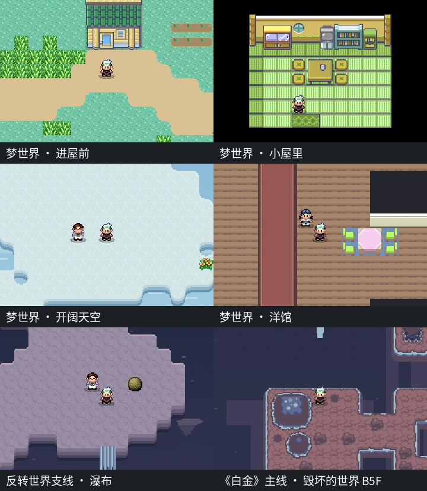

# 神奥毁坏的世界与跨区支线

神奥剧情使用《白金》的一楼、地下一至七楼、骑拉帝纳房及归途洞窟侧的房间。地图注册在神奥，和地区转移器里的四张「反转世界」观光支线分别计数。

## 剧情地图

每层按地图矩阵的偏移投影到小悠的 16 像素步行格。岩台、树和岩壁的轮廓取自地图模型，浮石、升降台和倒悬的平台读各层的独立物件表。岩面、晶体、水面各自使用缩减色阶。前方有升降台时，台面中心有浅色菱形标记。B4F 和 B5F 的逆流瀑布画在原来的冲浪换层处。第三层、第四层等区域的显隐物件读取原始分组、朝向和触发范围，进出房间会保留本层的显隐记录。原版在墙面上转动镜头的地方，本作把这一段展开成四向行走的平面。[《白金》毁坏世界的关卡控制器](https://github.com/pret/pokeplatinum/blob/485c400f9d7bad10d906d556ba23e5e46d5b3e5e/src/overlay009/ov9_02249960.c) · [模型与效果](https://github.com/pret/pokeplatinum/tree/485c400f9d7bad10d906d556ba23e5e46d5b3e5e/res/graphics/field_effects) · [原始平台数据](https://github.com/pret/pokeplatinum/tree/485c400f9d7bad10d906d556ba23e5e46d5b3e5e/res/prebuilt/fielddata/tornworld)

已有《白金》的场地网格、静态模型缓存及 apicula 后，以下两条命令可重画。第一条同时导出绿宝石色调使用的陨石瀑布岩面、主角家的木地板、墙面及武斗镇住宅。第二条将平台和升降台安装在原游戏数据的坐标。[绿宝石地图素材](https://github.com/pret/pokeemerald/tree/9103e529c2fbdd7add4a1ff3350c6c1f92112c42/data/layouts)

```sh
python3 tools/dream_distortion_fields.py /path/to/pokeemerald
python3 tools/platinum_rift_art.py /path/to/pokeplatinum /path/to/platinum-meshes /path/to/apicula /tmp/rift-effects
```

## 跨区支线

四张反转世界观光图分别走门槛、石柱、瀑布和归途祭台，按浮岛边界生成可走地面。梦世界采用《黑／白》联动空间的地点主题，在四向地图里另行布局。梦境小屋的门通往起居室。开阔天空的云带与脚下路径分层，洋馆用连续木板和地毯连接南北入口，海岸用浅色浪线标明水边。以下表格记录这十张图每张的实际移动和出口往返。[逐图步行表](side.tsv)


