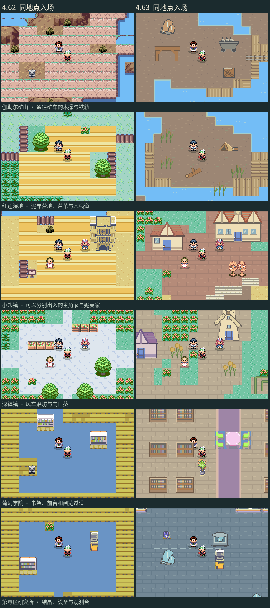

# 伽勒尔、洗翠与帕底亚的 GBA 地图

| 地区 | 4.62 登记地点 | 本次重绘现有地点 | 新增可进入的房间 | 现在登记地点 |
| --- | ---: | ---: | ---: | ---: |
| 伽勒尔 | 39 | 34 | 41 | 80 |
| 洗翠 | 9 | 9 | 6 | 15 |
| 帕底亚 | 43 | 43 | 53 | 96 |

伽勒尔的化朗镇、1 号道路和两栋房子的三张室内在 4.62 已经重画。表中的建筑逐扇接到本作的门口。新增房间按磨坊、市场、车站、研究所和住宅等用途布置，家具与居民活动空间使用《绿宝石》的画面和通行规则。各地共用本作的补给和治疗服务。



## 可以在游戏里走的三段路

- **伽勒尔**。从机擎市往西，经 3 号道路进第一矿山，沿运矿轨道走向 4 号道路。第二矿山在水舟镇和机擎市之间，有地下水道、抽水机和蓝色矿晶。两座矿山分别有 43×37 和 47×43 个步行格。拳关市可进入城堡，宫门市能进入竞技场草坪和洛兹大厦大厅。[伽勒尔官方旷野地带资料](https://swordshield.pokemon.com/en-us/gameplay/wild-area/)
- **洗翠**。祝庆村里有银河队总部、村民宿舍和工艺店，东行可以进入黑曜原野与红莲湿地。黑曜原野 83×59 格，红莲湿地 75×49 格，群青海岸 75×59 格，天冠山麓 75×59 格，纯白冻土 83×59 格。湿地的营地、泥岸、芦苇、水面和木道各有自己的落脚位置。沿山麓可以去神奥神殿，在柱列之间走到祭台。[洗翠官方场景与调查据点](https://legends.arceus.pokemon.com/en-us/story/)
- **帕底亚**。小匙镇沿海崖接小匙小径，主角家和妮莫家可以分别进出。在深钵镇可以走入风车磨坊，在渍沁镇可以走入市场，在锦汇镇可以走入宝食堂。城市之外，烘烘沙漠为 57×51 格，大锅湖为 51×51 格，两岸之间的桥面和周边可冲浪水面分开记录。[宝可梦官方帕底亚城市与地标图集](https://www.pokemon.com/uk/features/reminisce-on-pokemon-scarlet-and-pokemon-violet-with-the-pokemon-tcg)

这三代的自由镜头和大范围野外在本作里用了俯视、逐格移动的改编。每个地点分别指定了路线、岸线、地形组合、建筑、地标和入口视野，外形及道路距离是本作的 GBA 比例。三地的剧情、商店货单和开放世界系统仍以本作已经接入的内容为准。[逐地点地形与门位](../tools/switch_fields/landscapes.txt) · [入口地标位置](../tools/switch_fields/arrival_views.txt)

## 复核方法

`tools/test_switch_fields.gd` 在游戏的地图加载器里逐一读取这次修改的 186 张场景，从每张地图的出生点行走到各扇门，检查切图目的地和落脚格。在新增室内还走到补给商与护士面前按互动键。`tools/test_world_walks.gd` 另测全游戏跨区道路往返，覆盖帕底亚涟漪海堤两个相向的出口；`tools/test_postwick.gd` 检查新旧地图之间的化朗镇开场。

```sh
python3 tools/build_switch_fields.py /path/to/pokeemerald
godot --headless --editor --path . --import
godot --headless --path . --script tools/test_switch_fields.gd
godot --headless --path . --script tools/test_world_walks.gd
godot --headless --path . --script tools/test_postwick.gd
godot --path . --resolution 720x480 --script tools/capture_field_views.gd -- /absolute/path/to/pictures hisui
```

重绘器使用开源还原工程解读现有的《绿宝石》地块、调色板、家具和房间通行层，并另画港口、矿车、城堡、风车、市场、书架等道具与建筑。可在相同版本的原版数据上重建。[《绿宝石》原始布局](https://github.com/pret/pokeemerald/tree/9103e529c2fbdd7add4a1ff3350c6c1f92112c42/data/layouts)
