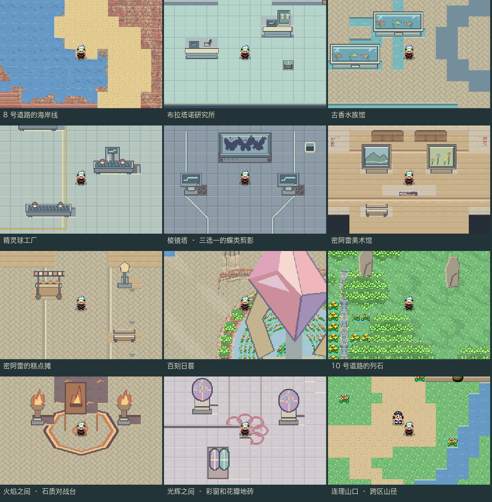

# 卡洛斯地图

《X／Y》的地区图、地图分区、房间编号和出入口目标取自 3DS Guide Library 所整理的原游戏资料。[卡洛斯地图与区域数据](https://3ds.pzfans.com/pokemon-x-and-y/pokemon-x-and-y-kalos-map/)

原数据有 360 个区域记录，共用 219 个场景视图。游戏内有 355 张卡洛斯地图，另有通往帕底亚的跨地区道路。镜头、过场与地形变体合并到对应地点。7 号道路在卡比兽所在的桥处分为东西两段。石香镇的三块巨石、升起的最终兵器与武器发射后的弹坑使用原版三个场景。

区域的原始编号保存在 `kalos_zone`。一般城镇道路、洞窟和室内从原分区与场景材质计算占地，在原作每 18 单位一步的格网上转换为四向移动。遇敌表按原区编号选取。草丛和花丛从原植株分布提取。原有实例缺少花色，按该区实际出现的花色分配整片花床。

能取得坐标的原版出入口保留来源索引和配对关系。原作以脚本运行的电梯、索道、单轨列车、专列及缺少位置数据的街道入口按原区域连接重新安排可步行的上下客点。缺坐标的密阿雷商户和演员使用适配后的站位。方向、门口、相邻落点和演员靠近位置逐图检查。模型表面生成的碰撞以及三维斜面、轨道和悬空道路的平面改绘，可能与 3DS 上的逐格路线不同。

小悠的房间、客厅、各市宝可梦中心、七座道馆机关和密阿雷大道沿用已有的绿宝石绘制。4.63 补绘了其余 315 个原作区域实例、石香镇武器发射后的弹坑和连理山口。X/Y 模型提供地形高低、房屋轮廓和窗户位置，地表、墙面、屋顶、木材、玻璃和水岸使用绿宝石图块与像素画材重新绘制。7 号道路的东西脚本区间共用一幅连续地图。各地的连锁中心和部分重复室内沿用原作共同的房型。

普通住宅、咖啡厅、旅馆、研究所、关口等室内陈设按房屋用途布置。新增家具的底部实际挡路。放置时保留来路与出路、剧情演员交谈位置以及全部入口落点。宝可梦联盟的走道和对战台、古香水族馆的参观廊、工厂传送带与生产通道、洞窟的可行走地面以及海岸使用实际碰撞、水域和走路格绘制。百刻日晷另有水晶柱与支撑座。棱镜塔四间题厅的屏幕分别显示真题剪影，密阿雷美术馆三层有不同题材的画框，南北街巷能看见糕点摊、花车与街灯。8 号路海岸、10 号路立石、17 号路积雪、镜穴晶壁、终结洞窟矿支架和最终兵器控制台分别按地形安排。205 张区域图共有 659 件带碰撞的补绘设施。涉及三维高差的建筑仍是适配本作俯视镜头的平面改编。

卧室墙上的地区图可查看各城镇与道路。

### 朝香镇到白檀森林入口

这一段有四张连续的室外图和三间名水镇室内图。朝香镇为 31×22 格，１号道路为 15×16 格，名水镇为 31×33 格，２号道路为 23×37 格。每格使用 16×16 像素的原生绿宝石图块。重建按《X／Y》的地点顺序和建筑用途布置，保留庭院、出门会合的位置、没有野生遇敌的短道、河桥、西侧露天桌和森林入口。[名水镇原版布局与店铺](https://bulbapedia.bulbagarden.net/wiki/Aquacorde_Town)

名水镇西侧蓝顶店出售精灵球，每个 200 元。东南红顶店出售伤药，每瓶 300 元。东北民居可回复全队，东南散步的男士会赠送一瓶伤药。喷泉围边和桥栏有碰撞。道路出口接受并排三格通行，居民的家门按门扇所在的一格进出。

旧版存档停在这七张图时，首次读档按原门口或邻近地标移到可步行的相应位置。旧档停在家门会回到门外，停在旧喷泉会回到喷泉南侧。下一次存档会记录新坐标。这次的新版开局实测从标题走过领取伙伴、回家交信、捕捉教学和白檀森林，另外逐家往返、买球、买药、回复、核对单次赠药，并对七种旧坐标各连续读档两次。

道馆的攀爬、钟摆绳索、星空步道改成可用方向键从头走到尾的分层路线。白檀蛛网保留通往馆主的露珠路线和可选对手。娑罗保留四名轮滑手的战斗门槛。棱镜塔保留四轮剪影、三种选择、对应训练家和答错后重试。香薰保留九室十二对传送点，入口的馆主捷径于获得徽章后开放。映雪保留四色机关、四名守卫与两段中央冰桥。白檀和香薰的机关图对照 Daniel Chaviers 实地制作的示意图重绘。[白檀蛛网](https://vgmaps.com/Atlas/3DS/PokemonXY-SantaluneCity-Gym.png) [香薰传送点](https://vgmaps.com/Atlas/3DS/PokemonXY-LaverreCity-Gym.png)



## 本地重建

准备 Python 3、NumPy、SciPy、Pillow、meshoptimizer、C 编译器，以及供室内图块使用的 pret/pokeemerald 本地检出。[pokeemerald](https://github.com/pret/pokeemerald)

```sh
python3 tools/fetch_kalos_maps.py /tmp/kalos-atlas
python3 tools/build_kalos_surfaces.py /tmp/kalos-atlas --jobs 4
python3 tools/kalos_rooms.py /path/to/pokeemerald
python3 tools/build_kalos_maps.py /tmp/kalos-atlas --emerald-source /path/to/pokeemerald
python3 tools/test_kalos_maps.py
godot --headless --editor --import
python3 tools/test_kalos_opening.py --godot godot
godot --headless --script tools/test_world_walks.gd
godot --headless --script tools/test_world_returns.gd
```

已导出的地图、碰撞与游戏贴图随仓库提供。运行游戏无需下载 3D 模型。
