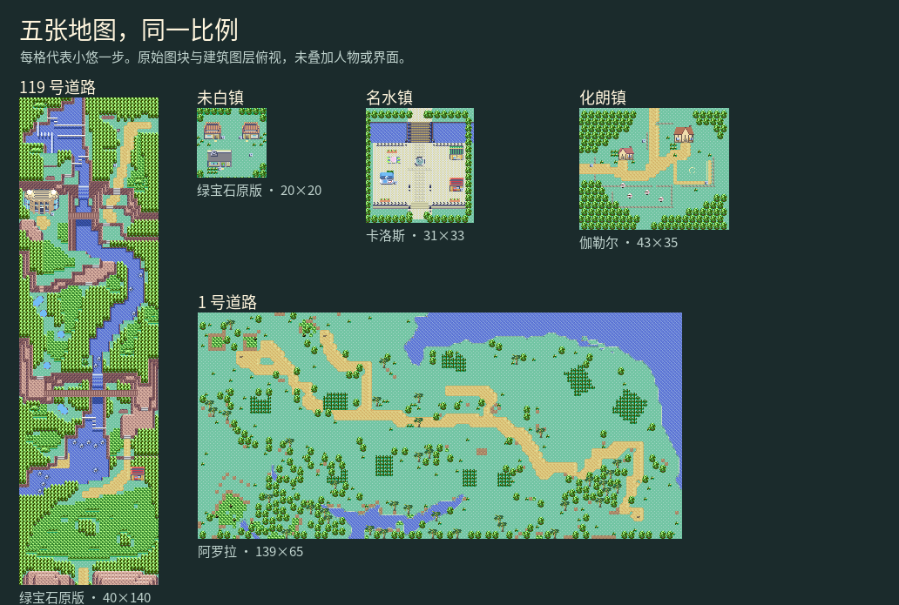
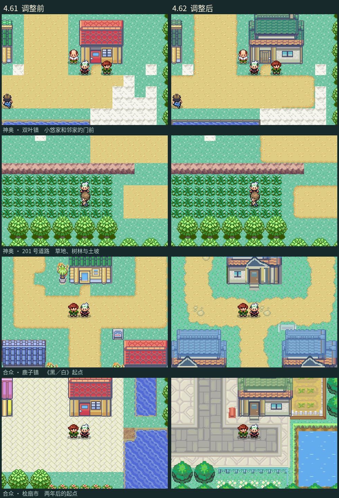
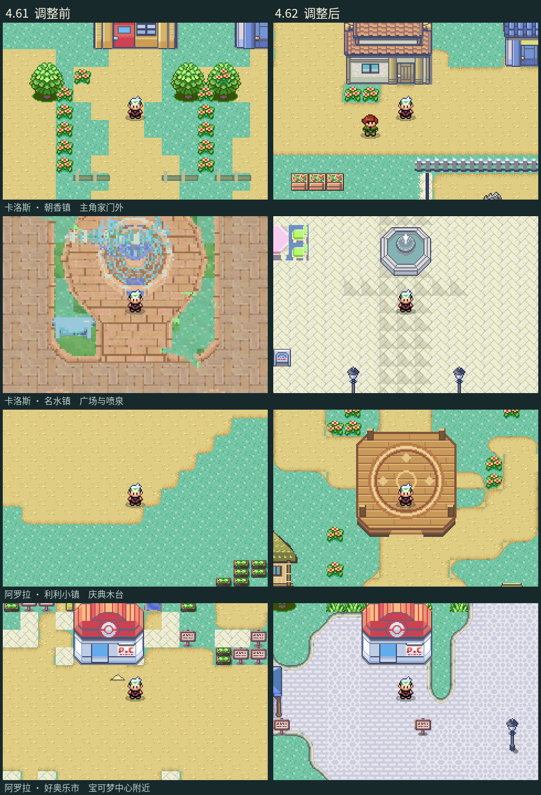
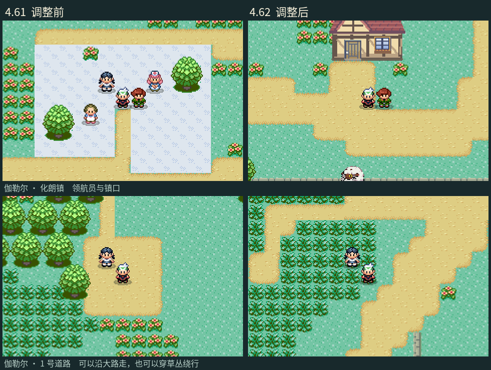
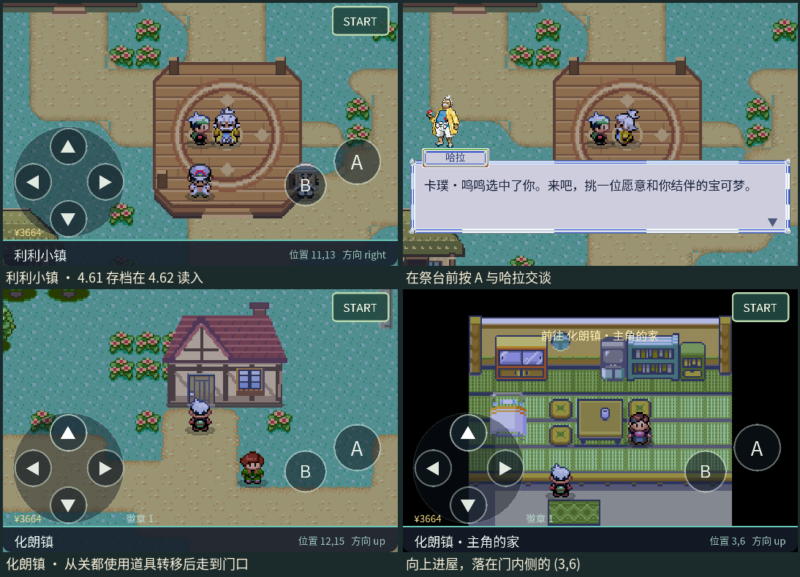
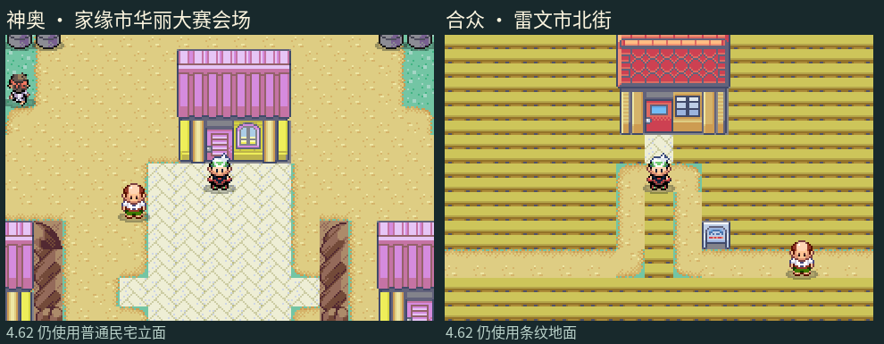

# 后世代地图、建筑和道路对照

4.61 的路线测试能证明小悠走得到目的地。它漏掉了游玩时最明显的问题：利利小镇的御三家事件站在空地上，化朗镇有屋顶却进不了家，伽勒尔两座矿山进门看起来几乎一样。

## 绿宝石的地图有多复杂

按原版地图组清点，《绿宝石》有 34 组、518 个地图 ID，共用 441 份地块布局。房间、楼层、秘密基地和设施分别占用 ID。下表按原版文件直接读取。对象数是脚本可使用的对象定义数，其中包含按剧情轮换的角色；每一行的地块种类是该图实际使用的不同 16×16 像素 metatile 编号数。[原版地图组](https://github.com/pret/pokeemerald/blob/9103e529c2fbdd7add4a1ff3350c6c1f92112c42/data/maps/map_groups.json) · [原版布局](https://github.com/pret/pokeemerald/blob/9103e529c2fbdd7add4a1ff3350c6c1f92112c42/data/layouts/layouts.json)

| 原版地点 | 宽×高（步行格） | 房门等传送点 | 相邻地图连接 | 对象定义 | 地块种类 |
| --- | ---: | ---: | ---: | ---: | ---: |
| 未白镇 | 20×20 | 3 | 1 | 8 | 63 |
| 101 号道路 | 20×20 | 0 | 2 | 6 | 31 |
| 119 号道路 | 40×140 | 2 | 2 | 43 | 254 |
| 卡那兹市 | 40×60 | 12 | 3 | 16 | 229 |
| 凯那市 | 40×60 | 11 | 3 | 35 | 356 |

未白镇的三扇门通向主角家、邻家和研究所，往北还有通向 101 号道路的镇口。119 号道路以河谷、桥、长草群、气象研究所和岸边的房屋组织沿途视野。同样是 40 格宽，玩家走在路上看到的地标和可以去做的事差别很大。[未白镇](https://github.com/pret/pokeemerald/tree/9103e529c2fbdd7add4a1ff3350c6c1f92112c42/data/maps/LittlerootTown) · [119 号道路](https://github.com/pret/pokeemerald/tree/9103e529c2fbdd7add4a1ff3350c6c1f92112c42/data/maps/Route119)



图上能直接看到剩下的差距。阿罗拉 1 号道路的外框已经很大，路外仍有大片用途相近的草坪。《绿宝石》119 号道路每一段都有河道、桥、长草或者高低差改变走法。

## 各作原始资料和 4.61 发布包

右列来自实际 APK 的地区专用资源。按一份可由地图加载器读取的场景数据计一张，多个出口格可以通往同一个房间。左列保留原作的数据单位，DS 地图头、3DS 分区模型和 Switch 连续野外有各自的划分方式。

| 地区 | 原作资料 | 4.61 地图文件 | 在游戏里看到的差距 |
| --- | --- | ---: | --- |
| 丰缘 | 518 地图 ID／441 布局 | 503 份绿宝石专用地图 | 使用原生地块、地面行为和建筑门位，可用作游戏内基准 |
| 城都 | HGSS 地图编号上限 540，含关都和技术场景 | 518 份 HGSS 数据 | 早先已参考 Heart & Soul 做 GBA 地标，保留 HGSS 的方格矩阵与部分共用房间 |
| 神奥 | 《白金》地图头表在 COUNT 前有 593 项，含系统项 | 551 | 其中 311 室内、158 洞窟、62 其他室外、19 城镇、1 地下通道。双叶镇与真砂镇的 32×32 外框没有体现九栋房子各自的门脸 |
| 合众 | 《黑》427 个区域头；《黑 2》615 个区域编号 | 426／616 | 两个时代分别装载，含 50／154 张技术场景。相同尺寸的场景和多格出口不等于相同的内容 |
| 卡洛斯 | X/Y 场景资料有 360 个分区记录、219 个视图 | 356，含跨区通道 | 名水镇投影外框 126×87，只有五个直接目的地，门和桌子挤在中部；城镇整体很大，人物经过的街面反而空 |
| 阿罗拉 | 日月图集提供四岛模型与 71 个场景索引，分区模型可覆盖多个地点 | 192，含三张通道 | 1 号道路已经有 139×65 格。利利小镇 28×28，只有通往 1 号道路和马哈罗山路的两个出口，连祭典木台也没画 |
| 伽勒尔 | 《剑／盾》的旷野地带连接多座城镇，含可改变遭遇的地形、地点和天气 | 36 | 化朗镇 43×35，只有森林和道路两个出口；宫门竞技场与其他普通室内几乎同样空 |
| 洗翠 | 以祝庆村为据点进入不同生态的大区域 | 9 | 红莲湿地的到场视野是木板方台，银河队总部在普通室内只摆少量家具 |
| 帕底亚 | 《朱／紫》的城镇与野外连续相接，可以从不同方向抵达 | 43 | 小匙镇 39×27，只有一个出口。大锅湖、酿光市和渍沁镇的到场视野重复使用木板平台 |

神奥与合众的来源可查原版区域表。卡洛斯、阿罗拉的数量按可取得的原游戏场景图集计算。伽勒尔、洗翠、帕底亚取原作玩法和空间作对照。[HGSS 地图表](https://github.com/pret/pokeheartgold/blob/4e9563397ab4e5c407271472935f9e270ac6a804/include/constants/maps.h) · [白金地图头](https://github.com/pret/pokeplatinum/blob/485c400f9d7bad10d906d556ba23e5e46d5b3e5e/generated/map_headers.txt) · [黑／黑2来源与具体版本](../content/unova_native/SOURCES.md) · [XY 图集](https://3ds.pzfans.com/pokemon-x-and-y/pokemon-x-and-y-kalos-map/) · [日月图集](https://3ds.pzfans.com/pokemon-sun-moon/pokemon-sun-moon-alola-map/) · [剑盾旷野地带](https://swordshield.pokemon.com/en-us/gameplay/wild-area/) · [洗翠原野](https://legends.arceus.pokemon.com/en-au/story/) · [朱紫开放世界](https://www.pokemon.com/uk/pokemon-video-games/pokemon-scarlet-and-pokemon-violet)

## GBA 剧情重制参考

| 项目 | 这次能实际核对的内容 |
| --- | --- |
| [Pokémon Retro Platinum](https://github.com/sinnoh-remakes/pokeemerald-platinum/tree/e74208ef7922bb252ac585c07e73ddae5f3ee42d/data/maps/TwinleafTown) | 基于绿宝石引擎的白金重制。查看双叶镇、201 号道路、真砂镇的地图文件、地块和脚本，再把房门、篱笆与道路用本项目的绿宝石素材对位 |
| [Heart & Soul](https://github.com/PokemonHnS-Development/pokehns-expansion)、[CrystalDust](https://github.com/Sierraffinity/CrystalDust) | 都有公开工程，可以检查城都地标、建筑与事件如何在 GBA 表现。工程在城都已有对 Heart & Soul 的素材署名 |
| [Pokémon XY GBA Demake](https://www.pokecommunity.com/threads/pok%C3%A9mon-xy-gba-demake.495142/) | 作者展示了卡洛斯地图和密阿雷市的拆分方法。本次把它作为视觉参考，实际重绘使用已有的绿宝石素材和 XY 出入口 |
| [Ultra Eclipse](https://www.reddit.com/r/PokemonROMhacks/comments/1xj28fj/ultra_eclipse_an_alola_demake_new_main_menu_and/) | 作者有美乐美乐岛的 GBA 重制演示，能观察道路与小屋尺度。作者仍在制作岛屿试玩版 |
| [Sword and Shield Ultimate Plus](https://github.com/Ddaretrogamer/Sword-and-Shield-Ultimate-Plus) | 英文版作者公开补丁及说明。此次找到的仓库未提供可逐格查阅的地图源文件 |

## 4.62 实际修改

- **神奥**。双叶镇、201 号道路、真砂镇。按 GBA 参考稿对齐九扇门，给双叶镇南侧池塘加护岸，恢复真砂镇通向 219 号道路的沙滩。
- **合众**。《黑／白》六张、《黑 2／白 2》十二张，合计十二个不同地点。开场地图包括鹿子镇、桧扇市、算木牧场和两代的早期道路。地图、碰撞和门口来自各自时代，部分共用建筑模型作为轮廓参考。为 76 个室内入口配对了真实门位，94 处独立立面逐个检查过墙脚和水面。
- **卡洛斯**。朝香镇、1 号道路、名水镇、2 号道路和名水镇三间室内。朝香镇重排为 31×22，名水镇重排为 31×33。三座店面按门接入，喷泉、过河桥、御三家桌和穿森林的草地各有自己的位置。4.61 旧存档第一次读入时，按最近地标与通行格重新落脚。[七图改动与验证](卡洛斯地图.md)
- **阿罗拉**。利利小镇新增祭台、哈拉家和三间民居。好奥乐市重新布置中心、商店和市政设施；马哈罗山路与 1 至 17 号道路按岸线、树林、草丛和路口调整。观光服务中心和马拉萨达连锁店可以进门；购买的大马拉萨达可以带走。[阿罗拉地图](阿罗拉地图.md)
- **伽勒尔**。化朗镇、1 号道路与三张住宅室内重新制作。小悠可以进主角家和赫普家，上赫普家的二楼，再出门经过毛辫羊的草场。向西去微寐森林，向北穿过 1 号道路到木杆镇。保留治疗与补给服务。住宅比例、路线形状、草场和室内陈设是本作的 GBA 改编。[伽勒尔建筑参考](https://assets.pokemon.com/assets/cms2/pdf/video-game/sword-shield/Galar_Tour_Brochure_US.pdf)

左列来自 4.61 发布包，右列来自 4.62 发布包。截图使用实际游戏的原野渲染器和同一视野。原坐标改变的地点选相同地标，地图按小悠能站立的格子取景。签名安卓包在模拟器上覆盖安装后，4.61 的利利小镇存档也能在祭台上与哈拉交谈。









## 剩余的画面差距

4.61 的伽勒尔、洗翠、帕底亚共 88 个场景，逐张截取了小悠在入场位置能看到的画面。化朗镇和 1 号道路在这一版重做，其余地图仍保留原有布局。旧图集可以直接看出哪些城市、道路和设施共用同样的广场与入口。在神奥的家缘市，华丽大赛会场大门还套着普通民宅的立面。在合众的雷文市，北街仍铺着平行的黄色条纹。卡洛斯和阿罗拉中后段也仍有三维投影和通用地表，本轮没有逐格重画或人工走遍。[伽勒尔 36 张](../.github/preview/v4.62-review-galar.png) · [洗翠 9 张](../.github/preview/v4.62-review-hisui.png) · [帕底亚 43 张](../.github/preview/v4.62-review-paldea.png)



## 验证走到了哪里

神奥和《黑／白》从新档走到第一枚徽章，《黑 2／白 2》从同一剧情系统保存的“两年后”节点走到桧扇道馆第一枚徽章。卡洛斯从卧室经过名水镇和白檀森林到 3 号道路，实走六栋建筑的双向门，并在两家店核对售价和扣款。七张重排地图分别从 4.61 坐标读取，再次保存、退出、读入后位置稳定。

阿罗拉四个版本各从新档走到完成训练家学校。另用已开购物区的《究极之日》存档实走 952 步，逐个进出十二扇门，购买大马拉萨达后退出重开。伽勒尔实走 264 步、切换地图 34 次，包括户外三格宽的出口与赫普家楼梯，东侧主路可以完全避开遇敌草地。

## 复核命令

第一条直接读 APK 的 JSON 记录，并与本地原版解包资料比较。第二条截取仓库场景，末尾追加地区 ID 可按运行时登记表截该地区全部入场视野。若检验发布包，给 Godot 传入从 APK 的 assets/ 提取的资源 ZIP，使用绝对路径指定同一份截图脚本。抓图需要图形窗口。

```sh
python3 tools/audit_region_geometry.py --pack /path/to/PokeSaga-4.61.0-study.apk --emerald-source /path/to/pokeemerald
godot --path . --resolution 720x480 --script tools/capture_field_views.gd -- /absolute/path/to/screenshots
python3 tools/test_unova_facades.py
python3 tools/build_postwick.py /path/to/pokeemerald
godot --headless --path . --script tools/test_postwick.gd
```
