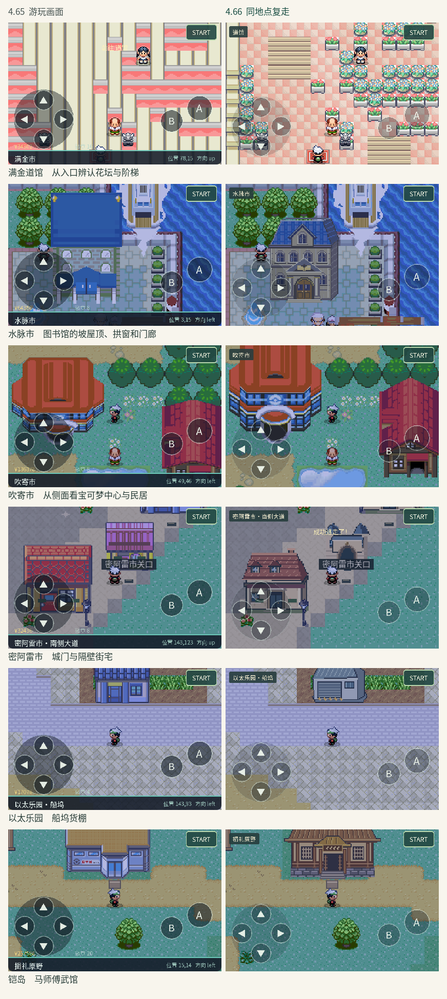
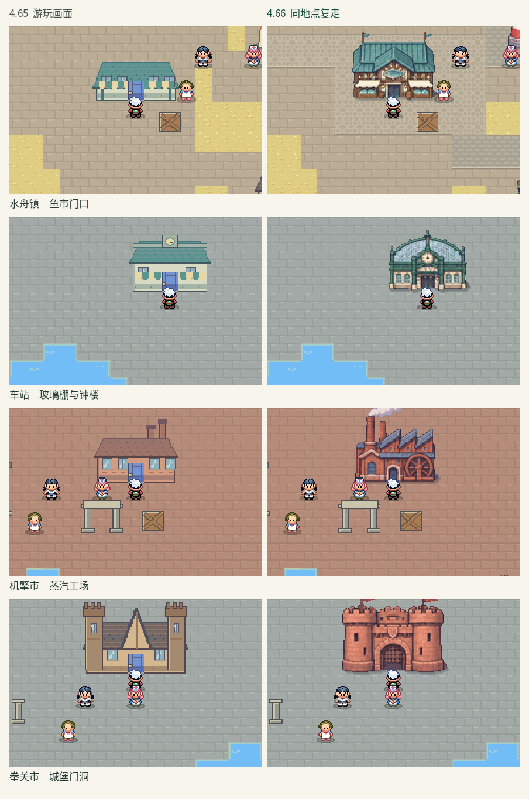
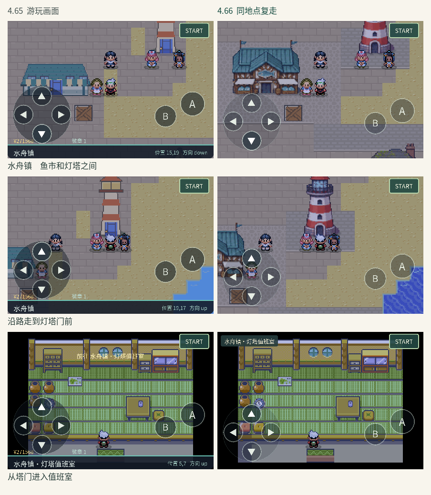

# 4.66 后世代建筑实走

从 4.65 的水舟镇存档出发，小悠走过鱼市、转向灯塔，进值班室再从正门返回。旧鱼市与住宅、工场、车站共用梯形屋顶和一扇蓝门。合众与卡洛斯也有扁平建筑，原因分别在地图的投影和材质转换。下表按实际走过的地点记录。

| 地点 | 原先玩到的情况 | 本版改动和复核 |
| --- | --- | --- |
| 城都满金道馆 | 进门后地面铺成一排排立柱，楼梯融进背景 | 依《心金／魂银》的地面材质和通行格重绘花坛、三处楼梯、通道和馆主位置。从满金市进馆，再退回同一扇门。 |
| 神奥水脉市 | 从街上走到图书馆门前，只看到一顶蓝棚和几根细柱 | 重画石蓝色屋面、侧墙、入口门廊与书徽。保留神奥原门位和碰撞，从街上走进一楼并从原门返回。 |
| 合众飞云市、吹寄市 | 从飞云市走进街道会提示内部编号。部分城镇的高楼压进了地面，吹寄市中心进屋就站在出门的触发格 | 飞云市两段年代重画街区与码头、入口写明去向。两作共 65 张外景拆出 382 个独立绘制的建筑和立面。31 处中心进门后往屋内落一格，逐个进门转身，再按下返回街上。黑色市移除了被不透明绘制的白云层，12 号与 14 号道路的门楼按实际进门朝向重绘。 |
| 卡洛斯白檀市、密阿雷市 | 一些屋顶画成了树叶，正面与侧面一样亮，很难看出墙体 | 重新映射原建筑贴图的屋顶和墙面，按朝向调整明暗。密阿雷城门、街宅、朝香镇和名水镇部分门面重画。沿朝香镇、名水镇、白檀市走到密阿雷。 |
| 阿罗拉好奥乐市、以太乐园 | 船坞摆着民居，大厅四个相邻出口通往四个目的地 | 好奥乐等地的 38 栋建筑补屋檐、侧墙和门洞。船坞 12 栋货运设施改成卷帘货棚与吊机。大厅电梯可找接待员选层，也可按地面方向离开。实际选过四站，未解锁时进不了实验区。 |
| 伽勒尔水舟镇等 13 张地图 | 鱼市和街角小屋很像，灯塔缺少灯室与塔身的立体感 | 用 20 种有独立轮廓的像素立面替换 45 处建筑。市场门旁有鱼箱，灯塔有环形护栏和灯室，车站有钟楼与玻璃棚。资产各自按门洞对齐原坐标。用地图移动系统从各地出生点走到 45 处门前。 |
| 铠岛、王冠雪原 | 武馆挂着道馆招牌，双塔入口像装饰物。车票写着滑溜坡，到站却是雪中溪谷 | 武馆、双塔、三座版本道馆场馆和王冠神殿重画。坐车抵达滑溜坡后，可经调查营地到冻凝村，再搭车回木杆镇。极巨大冒险可重走已调查的路线并带回一只沿途伙伴。 |

水脉图书馆旁的两条巷子都可以走。小悠分别沿东西墙走到屋侧，转向墙时被挡住。从门前向上进入阅览室，再向下回到街上。这段路线在 4.65 和 4.66 各走了一次。[水脉图书馆同机位大图](../.github/preview/v4.66-canalave-library.png)

伽勒尔这组立面用新绘的建筑原画制作，在各自的游戏像素尺寸内限制调色板，并把门槛对齐原有格子。水舟镇的路面、码头和波纹使用凯那市地块。可点开查看每种立面与小悠的比例。[20 种建筑的游戏内门前画面](../.github/preview/v4.66-galar-20-frontages.png)

## 触屏复核

水舟镇原版安卓包上，手指按住向右再滑到向上，小悠继续向右，必须抬手才能转弯。现在同一根手指可以转向，回到十字键中央会停步。按住 B 穿门后，切图前的触点会等到手指抬起才重新接管方向。地点名在进图时短暂出现，金额、徽章和测试坐标可在 START 菜单查看。

## 核对范围

城都、神奥、合众两作、卡洛斯、阿罗拉、伽勒尔及扩展地区选取了上述路线。地图生成器的批量渲染、通行检查、按键走访与安卓模拟器触屏复测分别记录。各城剩余房间、支线与版本独占地点仍待逐一实走。《欧米伽红宝石／阿尔法蓝宝石》和《Let's Go》的独立版本差异也待专门核对。卡洛斯部分路线仍采用固定视角绘景，神奥多数建筑与门口也待进一步同机位复核。

最终签名 APK 在安卓模拟器上覆盖安装 4.65，安装前后的存档文件逐字节一致。覆盖后实走了水舟镇鱼市到灯塔值班室，以及水脉图书馆的进门、出门。另用 APK 内的游戏资源跑了 12 项回归，跨地图步行覆盖 208 对出入口、416 次切图。

用图形窗口运行 `tools/capture_galar_facades.gd`，在 `--` 后传入一个绝对输出目录，可以按实际步行到达的门位重拍 20 张建筑图。去掉输出目录可在无窗口模式复核所有门位。以太大厅、城镇室内与跨区道路另由地区测试覆盖。[《白金》原版地图和事件资料](https://github.com/pret/pokeplatinum) · [《绿宝石》地块与布局](https://github.com/pret/pokeemerald/tree/9103e529c2fbdd7add4a1ff3350c6c1f92112c42/data/layouts) · [《剑／盾》铠岛原版环境](https://swordshield.pokemon.com/en-us/expansionpass/the-isle-of-armor/)
