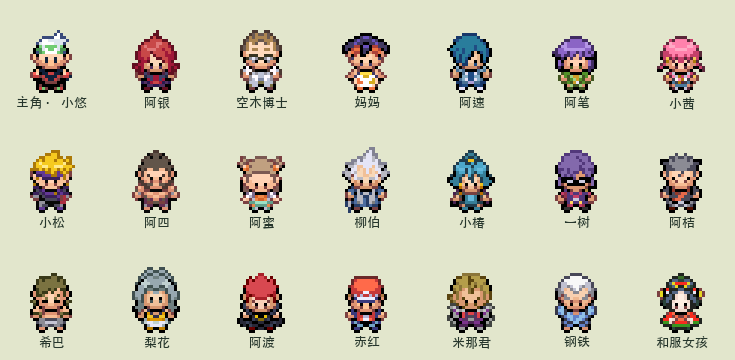

# 城都的绿宝石风格角色

主角沿用本项目原有的《绿宝石》小悠，步行和冲浪图直接使用原来的两张图集。城都剧情角色使用为 GBA 绘制的同名人物场地图。主角和成年角色按 16 × 32 像素原画显示。水流号的小女孩用 16 × 16 的儿童图，脚底与成人对齐在同一格。阿银、空木博士、城都八位馆主、一树、阿桔、希巴、梨花、渡、赤红、钢铁、米那君、和服少女和火箭队男女队员都有独立图样。

人物和剧情宝可梦的素材来源为 Lil Dill 与 Heart & Soul 团队的 Emerald 项目。该项目将精灵图作者列为 Cesare_CBass、AveonTrainer、PurpleZaffre 和 BatimaTheBat。图片位于源项目的 `graphics/object_events/pics/people` 和 `graphics/object_events/pics/pokemon`。按 GBA 调色板的零号色生成透明通道，保留原始像素、朝向和行走姿势。关都人物也按城都时代的身份显示，包括四天王阿桔和浅红馆主阿杏。[固定版本源码](https://github.com/PokemonHnS-Development/pokemonHnS/tree/751823abaf677020bcd72c45fe3e7cb2b8a576e4/graphics/object_events/pics) · [原作者署名](https://github.com/PokemonHnS-Development/pokemonHnS/blob/751823abaf677020bcd72c45fe3e7cb2b8a576e4/README.md#credits)

模型索引见 `assets/johto_gba/actors/cast.json`。安装 Pillow 后，在工程目录运行 `python3 tools/import_johto_cast.py /path/to/pokemonHnS` 可复建人物图集和桧皮道馆的圆丝蛛轨道车图案。轨道车以 38 × 32 像素描绘，黄色分节足、绿色外壳和红色口器围住中央金属座位。

广播塔二楼的小葵、四楼的胡桃、30号道路的宝可梦爷爷和龙之祠长老使用该 GBA 项目各自地图事件指定的人物图。五楼假台长现身时穿着绅士服，与地下仓库的真台长相呼应。[广播塔二楼](https://github.com/PokemonHnS-Development/pokemonHnS/blob/751823abaf677020bcd72c45fe3e7cb2b8a576e4/data/maps/GoldenrodCity_RadioTower_2F/map.json) · [广播塔五楼](https://github.com/PokemonHnS-Development/pokemonHnS/blob/751823abaf677020bcd72c45fe3e7cb2b8a576e4/data/maps/GoldenrodCity_RadioTower_5F/map.json)

常青市训练家之屋的卡尔沿用原作二代男训练家的外形。接待员带主角入场时，卡尔使用同一张绿宝石风格的行走图。[对应的 GBA 角色图](https://github.com/PokemonHnS-Development/pokemonHnS/blob/751823abaf677020bcd72c45fe3e7cb2b8a576e4/graphics/object_events/pics/people/brendan/walking.png)
