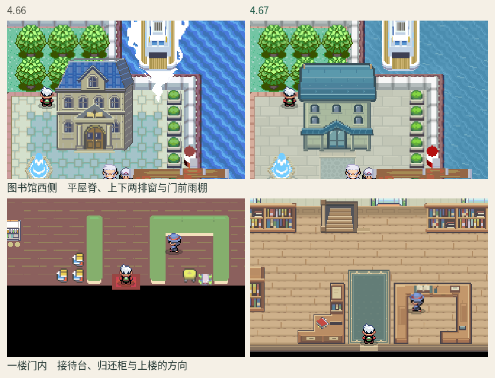
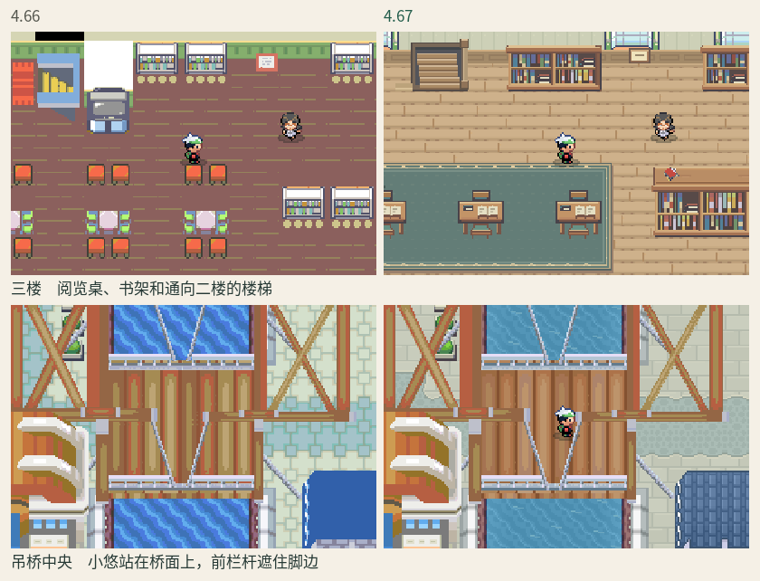
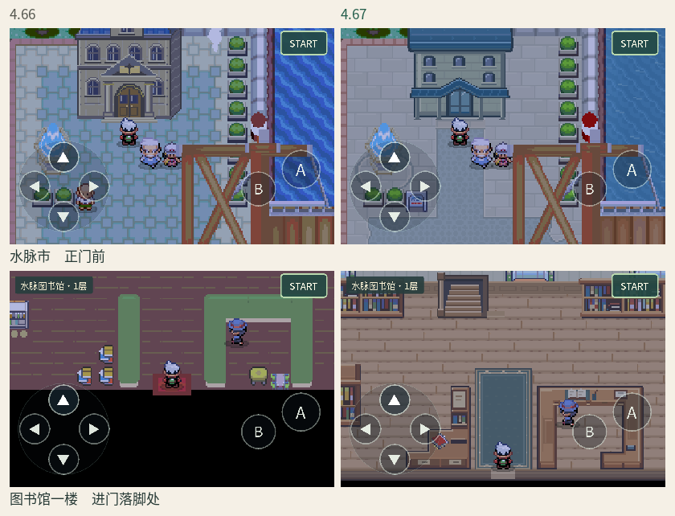
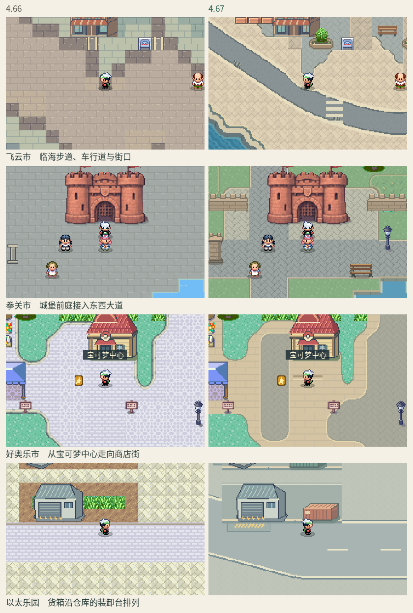

# 4.67 水脉图书馆与城市街面

## 水脉市

4.66 把图书馆画成了带老虎窗和尖门楣的建筑。对照《白金》的现场画面和地图模型后，恢复了青蓝色低屋顶、两排矮窗与通长雨棚。门前石材接到图书馆牌子、喷泉和西岸步道。五栋沿岸民宅的屋顶有了瓦片，四艘停泊的船也去掉了行驶中的浪花。[《白金》原版街景](https://www.pokepedia.fr/images/1/17/Biblioth%C3%A8que_de_Joliberges_Pt.png)

沿西岸继续走到吊桥，4.66 会让桥板挡住小悠全身。现在桥板在脚下，前侧钢架和栏杆仍能遮住脚边。用同一份旧档在两版走过图书馆两侧，读门外牌子，进馆再出门，过吊桥抵达东岸民宅。

## 从一楼走到三楼

从门口能看到接待台、归还柜和楼梯。地板取自《绿宝石》小悠的家，窗户取自卡那兹市训练家学校，书架用到了小田卷研究所和凯那市的书脊像素。相机按房间实际边界移动。二楼的普通书架和北墙书架都可以读，三楼七组书架可以阅读、续读或放回，民间传说可以分别选三篇。

用拿到第六枚徽章的旧档从街上出发，沿原楼梯上三楼，触发山梨博士与三湖的剧情，原路回到街口，再回三楼。复走检查了前台在震前、震后的两种回应，以及博士一行离开后的阅览室。[《白金》三楼原版事件脚本](https://github.com/pret/pokeplatinum/blob/main/res/field/maps/canalave_library_3f/scripts.s)

## 其他地区

| 地点 | 这版可以走到的变化 |
| --- | --- |
| 合众飞云市，两段年代 | 滨海步道沿岸转弯，中心车道在码头前有斑马线。木栈桥接上五个登船口，街道铺面延伸到各自入口。长椅、树池和系船桩按沿岸位置放置。两段年代各从街上走进了五个码头。 |
| 伽勒尔拳关、机擎、水舟、宫门、尖钉和木杆 | 城堡前庭、工场、车站、市场和滨海观景台有各自的脚下材质。拳关南门从水面移到真实的石路两侧，码头木板只出现在船边与卸货处。六城分别从存档步行复核过。 |
| 卡洛斯密阿雷市 | 七个街区的马路、人行道和草坪分别收边，城门前的步道沿路口转折。 |
| 阿罗拉好奥乐市、以太乐园 | 宝可梦中心门前的人行道通往商店街。以太船坞有装卸车道、货箱和靠岸的船，东西两侧都保留原登船口。 |

最终签名包在安卓模拟器上直接覆盖 4.66，安装前后的存档文件逐字节相同。触屏实走了飞云市滨海步道、水脉图书馆的进门和出门。另从这个 APK 读出游戏资源，沿第六枚徽章后的存档实走 158 步，两次往返三楼；12 项地图、存档、切图与剧情回归均通过。

这轮按上述地点核对地面、碰撞、门位和走路时的遮挡。其余城镇、乡间道路和室内地板仍待逐图走查。[《黑／白》官方飞云市游戏演示](https://www.youtube.com/watch?v=rIpAiBStRys)
